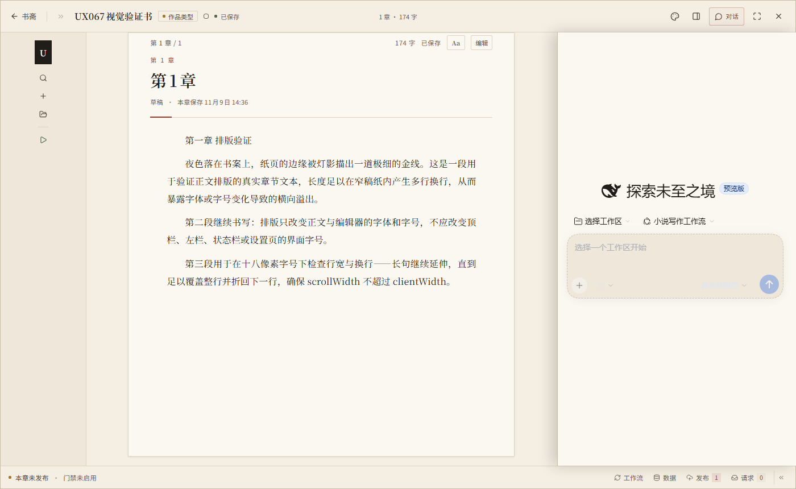
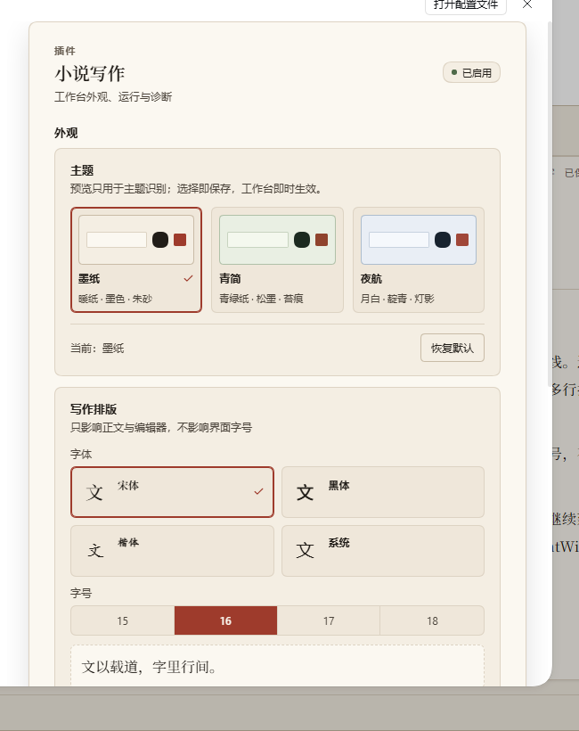

# dsh-novel-writing

> 把 DSH 变成一个能管理多部小说、把写作流程跑成可审阅流水线的写作插件：不是“一键生成小说”，而是让选题、大纲、正文、审查、发布和数据复盘都有状态、有门禁、有人的决策。

当前版本：**0.6.0** · 兼容性与迁移边界见下文第 4 节。

## 1. 插件目标

写网文真正难的不是让 AI 生成几段文字，而是：

- 选对赛道，不写到一半才发现方向错了；
- 大纲不崩、正文不离纲；
- 审查不放水，发布前没有硬伤；
- 多部小说能管理，不靠手工翻目录；
- 发布后的数据能反馈到下一轮写作。

本插件做三件事：

1. **管理多部小说**：工作区、书目、章节、文件、绑定会话、发布与数据，一套界面管理。
2. **把工作流做成可执行的流程**：29 个 SKILL、16 个专业 Agent、Coordinator 协作，关键节点必须由人确认。
3. **把门禁从“AI 自觉”变成代码约束**：保存、审查、发布、数据信号由代码检查，语义审查由专业 Agent 完成。

明确不承诺“自动赚钱”。目标是提高从选题到上架、复盘的可控性；收益仍然取决于内容、平台和市场。

## 2. 界面设计与交互逻辑

### 书斋

打开插件先看到书斋：当前书、上次写到哪、一键续写、书架和搜索。

- 空书架给一句话和一个主按钮，不让用户面对空白表格。
- 书目卡片直接进入写作台；不先要求用户理解会话、工作区、绑定这些内部概念。

### 管理控制台

用于管理多部小说和工作区：

- 新建/切换工作区；
- 新建、删除、拖拽排序书目；
- 搜索书目和会话；
- 每本书显示阶段、字数、发布状态、数据信号和绑定状态。

### 写作台

一本书一个写作台：

- 顶栏：返回书斋、书名/阶段、全局状态、主题、专注、对话、更多。
- 左栏：章节目录、搜索、资料、新建章节；可折叠为图标栏。
- 中间：稿纸式阅读/编辑；首行缩进、行宽受控、真实页码。
- 右侧：按需打开的宿主原生会话抽屉；打开时仍保留宿主顶栏、左侧会话栏和插件状态栏。
- 状态栏：本章发布状态、门禁、字数、工作流/数据/发布/请求入口。
- 下方面板：工作流、数据、发布、请求；可开关、可拖动调高度。
- 专注：隐藏插件左栏、抽屉和状态栏，把空间还给正文，但不遮挡宿主 chrome。



### 视觉与可读性

- 三套主题：墨纸（默认）、青简、夜航；每套跟随宿主明暗。
- 正文与编辑器可独立选择宋体/黑体/楷体/系统和 15/16/17/18 字号；只影响正文，不影响界面 chrome。
- 稿纸、对话框、设置页共用同一色系，避免白色宿主面板和工作台暖纸面割裂。



### 交互原则

- **一本书对应一个会话**：点书目卡片进入该书工作台，未绑定则自动创建会话。
- **人是最终决策者**：阶段切换、方向调整、发布、删除等关键动作走明确的用户确认。
- **真实数据**：对话、章节、保存时间、门禁、发布和数据都是真实数据；不伪造消息、差异、页码或数据。
- **手动保存优先**：保存时跑门禁；不通过拒绝写盘；人工强制保存会留痕并提示重审。
- **一个入口做一件事**：对话只保留一个带文字的「对话」入口；专注和抽屉互斥；不遮挡宿主管理界面。
- **状态可恢复**：布局、主题、字体、面板高度、工作台和抽屉状态在刷新后保持。

### 设置页

插件设置只放插件级内容：

- 外观：主题、正文排版；
- 运行：启用插件、轮询间隔、预设自动同步、API LAN 访问；
- 诊断：只读契约投影；
- 业务配置位置：告诉用户工作区、发布、绑定在哪里，而不是把所有配置堆在设置页。

## 3. 工作流设计与为什么它能达成目标

### 主流程

```text
作品类型
  → 平台调研 / 竞品分析
  → 题材选择 / 作品确认 / 创作规划
  → 大纲（三审）
  → 章节细纲（三审）
  → 正文生成（看护门禁）
  → AI 合规
  → 质量审查（6 审）
  → 上架发布 / 变现
  → 数据监控 → 读者互动 → 下一轮调整
```

每个阶段都有结构化产出、进度面板和下一步选择；不是让模型自由发挥到结束。

### 组成

- Coordinator：负责阶段推进、分派专业 Agent、汇总决策。
- 29 个 SKILL：把选题、平台、竞品、大纲、细纲、正文、审查、发布、数据等步骤固化为可复用技能。
- 16 个专业 Agent：平台、商业、连续性、角色、节奏、AI 痕迹等审查分工。
- `tool-novel`：把门禁、章节保存、审查提交、发布、数据入库等机械动作变成工具，而不是提示词约定。

### 为什么当前工作流能达成目标

1. **机械可判的门禁由代码执行**
   场景覆盖率、偏离项、保存阻断、审查提交有效性、发布合规、数据信号阈值都由代码检查；不依赖模型“记得检查”。

2. **语义审查由专业 Agent 执行**
   逻辑、角色、连续性、商业、体验、AI 痕迹等无法完全机械化的部分，交给分工明确的审查 Agent；代码负责记录和阻断。

3. **结构化状态可恢复**
   作品使用 `workflow-state.json` 保存阶段和产出；章节元数据、门禁结果、发布记录、数据信号落在项目目录；换会话、重开工作台、刷新页面都能接着走。

4. **人的决策保留在关键节点**
   AI 不替用户决定题材、方向、发布和止损；用户确认后才推进。AI 参与度沿用 A/B/C 分级，高风险参与度不会伪装成可上架。

5. **数据闭环**
   发布数据入库即检查完读率、流失、追读、收藏、收益信号，再给出重审、重写、节奏调整或止损建议；调整必须回到大纲/细纲/正文的可控层级。

6. **真实环境约束**
   平台数据来自真实搜索或用户配置的抓取命令；没有来源的结论会标注推测；不承诺绕过平台风控或无人值守发布。

## 4. 兼容的 DSH 版本

| DSH 版本 | 状态 | 说明 |
|---|---|---|
| `0.1.2-rc.1` ~ `0.1.x` | 支持 | 旧表面；`0.1.5-rc.2` 为完整支持基线；使用 `agent.cordis.yml` 的 legacy 预设通道 |
| `0.2.0-rc.2` / `0.2.1-rc.2` | 可加载，非完整支持 | 预设可加载；宿主未在主包注册独立 `list_agents`，该能力不可用，不伪装为完整支持 |
| `0.2.2-rc.1` | 推荐（当前实测基线） | 0.2.x 声明预设；`list_agents` 由主包提供；预设加载与工作台挂载已实测 |

0.1.x 使用包内 `agent-presets/novel-writing/agent.cordis.yml`，0.2.x 使用 `cordis.patch.yml` 的预设声明；两份源文件不能混用。0.2.0/0.2.1 的独立 `list_agents` 缺失是宿主能力差异，不是插件静默补上的功能。

其他要求：

- Node.js **>= 20**
- DSH Web / Desktop 均可；插件客户端面向 web 宿主，桌面端使用同一套客户端表面
- 安装后需要重启 DSH 一次，让 bundle 和客户端插件生效
- 兼容性细节以 [docs/COMPATIBILITY.md](docs/COMPATIBILITY.md) 为唯一权威；升级 DSH 前建议先跑 `node scripts/preflight-preset-rows.mjs`

## 安装

```sh
# 按你的宿主 profile 替换 web；桌面端通常是 desktop
dsh plugin --profile web add peterwangze/dsh-novel-writing
dsh plugin --profile web update dsh-novel-writing
dsh plugin --profile web remove dsh-novel-writing
```

安装后：

1. 重启 DSH；
2. 首次启动会自动同步「小说写作工作流」预设；
3. 打开侧栏「小说管理工作台」，创建第一本书，或把 [examples/demo-novel](examples/demo-novel) 复制到工作区直接体验。

离线安装、旧版 profile 布局和手动安装见 [install.ps1](install.ps1) / [install.sh](install.sh) 以及 [docs/COMPATIBILITY.md](docs/COMPATIBILITY.md)。

## 快速开始

1. 安装并重启 DSH。
2. 打开「小说管理工作台」，新建工作区和书目。
3. 点击书目进入写作台；未绑定会话会自动创建并绑定。
4. 在工作流面板开始/继续流程，按阶段做选择。
5. 在稿纸里阅读、编辑、保存；保存会跑门禁。
6. 发布后在「数据」页看信号，决定下一步调整。

## 边界与非目标

- 不绕过平台风控，不做无人值守发布；自动发布默认关闭，必须由用户显式配置。
- 不把 AI 代写成“人类原创”；AI 参与度沿用 A/B/C 分级。
- 不伪造对话、差异、页码、章节数或平台数据。
- 不自动删除小说；删除必须显式确认。
- 不在设置页重新堆放业务配置；工作区、发布、绑定在对应工作台完成。
- 不承诺收益；只提高过程可控性和复盘效率。

## 项目结构

```text
lib/
  index.js              宿主服务、HTTP API、预设同步
  client.js             书斋、写作台、主题/排版、宿主抽屉适配
  host-boundary.js      宿主 API 边界与双表面适配
  host-contract.mjs     宿主耦合契约（单一事实源）
agent-presets/novel-writing/
  agent.cordis.yml      0.1.x 预设源
  skills/               29 个 SKILL
  agents/               16 个专业 Agent
cordis.patch.yml        0.2.x 预设声明
scripts/                几何、契约、探针、预检
test/                   smoke / preset 校验
docs/                   DESIGN / COMPATIBILITY / 调研与设计证据
```

## 开发与验证

```sh
node --check lib/client.js
node test/validate-preset.mjs
node test/smoke.mjs          # 367 项断言
node scripts/verify-visual-geometry.mjs --strict
node scripts/verify-contract-anchors.mjs
node scripts/preflight-preset-rows.mjs
```

真实工作台验收使用隔离 DSH profile + 临时 `DSH_HOME`，覆盖 1680/1152/956/800 等宽度、浅/深主题、抽屉、专注和设置页；不以合成 DOM 代替真实宿主。

## 文档

- [设计方案](docs/DESIGN.md)
- [兼容性设计与版本矩阵](docs/COMPATIBILITY.md)
- [市场/源工作流/DSH 生态调研](docs/RESEARCH.md)
- [示例小说](examples/demo-novel)
- [更新记录](CHANGELOG.md)

## License

MIT
