# UX-064 工作台重构设计提案 · 墨纸

- 状态：**设计评审稿，待用户审核**。审核通过前零产品代码改动。
- 日期：2026-11-08
- 范围：小说管理工作台（书斋）+ 写作台 + 专注模式 + 空态 + 组件规范
- 设计稿：`docs/design/UX-064-mockups/`（4 个 HTML + 9 张 2× 截图 + 总览图）
- 关联：UX-061 / UX-062 / UX-063（设计与实现收口），DEC-162

---

## 0. 一页结论

旧界面不是「再修几个像素」能解决的问题。它把小说工作台做成了一个**管理后台**：首屏是任务卡片，写作台是 IDE 式的页签、文件树和检查器，正文被挤在中间一条窄栏里。用户第一眼看到的是控件和数据，不是书，也不是稿纸。

这次重做的核心不是换皮，是换**隐喻**：

> 从「管理工作台」变成「书斋 + 稿纸」。
> 一本书在正前方，一个动作最重，正文以阅读宽度展开，对话像页边批注一样待在手边。

具体变化：

| 维度 | 旧 | 新 |
|---|---|---|
| 首屏任务 | 今天写什么 / 待办 / 最近章节，四块并置 | 当前书 + 上次写到 + 一键续写；书架退到第二层 |
| 进入写作 | 选书 → 首页 → 点章节 → 写作台 | 书斋「打开第 38 章」直接落到正文末尾；续写直接开第 39 章 |
| 写作台骨架 | 页签 + 文件树 + 章节列 + 检查器 + 对话 | 顶部书脊栏 + 章节目录 + 稿纸 + 协作编辑 + 一条安静的状态栏 |
| 正文地位 | 1440×900 下约 236px，约 15 字/行 | 稿纸 588px，约 34–36 字/行；专注模式 680px |
| 视觉语言 | 宿主席官色 + 卡片 + 分割线堆叠 | 暖纸、墨色、朱砂一点；衬线标题/正文，无衬线 UI |
| 空态 | 居中一句「尚无书目」，大片空白 | 一句话 + 一个主按钮 + 三步说明 + 书脊上的虚线位 |

设计稿总览：

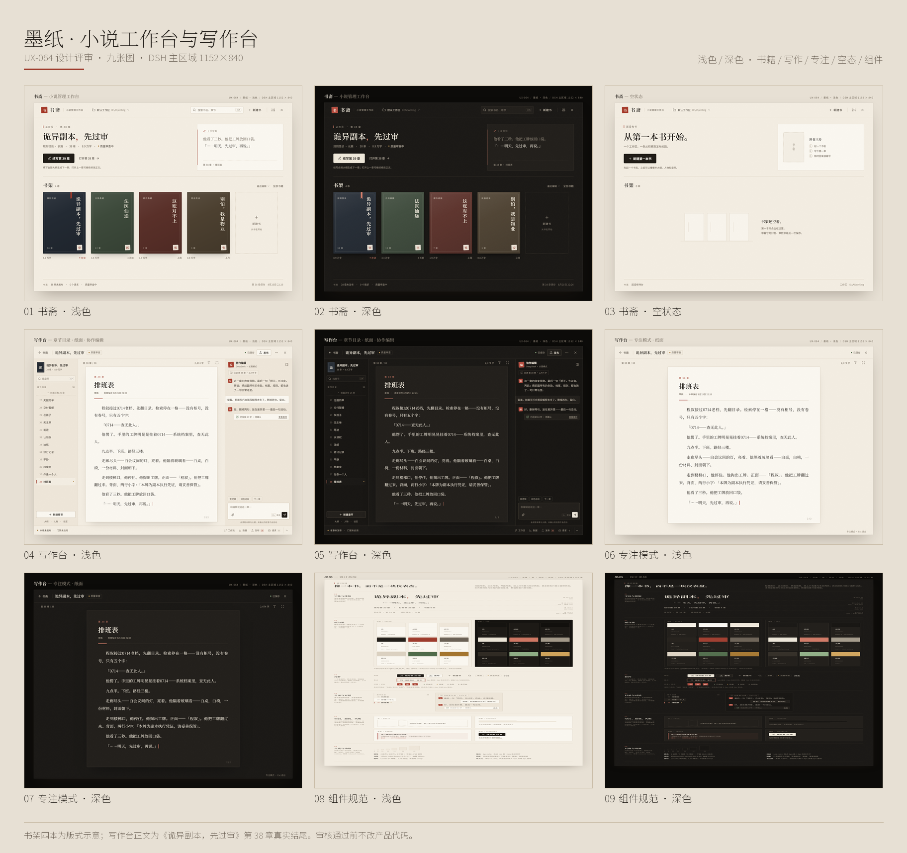

**审核对象**：`书斋`（浅/深）、`书斋空态`、`写作台`（浅/深）、`专注模式`（浅/深）、`组件规范`（浅/深）。审核通过后，按 §8 的三批实现；不通过则只改被点名的部分，不擅自扩大范围。

**数据诚实声明**：书架上 4 本书中，只有《诡异副本，先过审》是真实项目；其余 3 本是**版式示意数据**，用来压测 4 本以上书目的排布，不是真实书目。写作台正文是真实第 38 章《排班表》的结尾原文（节选），对话与「已压掉 63 字」是交互示意；书架字数、章节数等示意数据已在图中按真实项目口径标注。所有时间按本地时区显示：工作流状态 `2026-09-23T03:37:24.581Z`（本地 `9月23日 11:37`）是**统计状态更新时间**，不是正文保存时间；写作台与书斋里的「本章保存 8月25日 22:26」取自 `07-content/chapter-038.md` 的文件 mtime。

---

## 1. 诊断：为什么「完全不行」

### 1.1 旧首屏：任务卡片，而不是书

旧首屏（BUG-012 取证，测试书 `bug012-验证书`，0 字/0 章）：

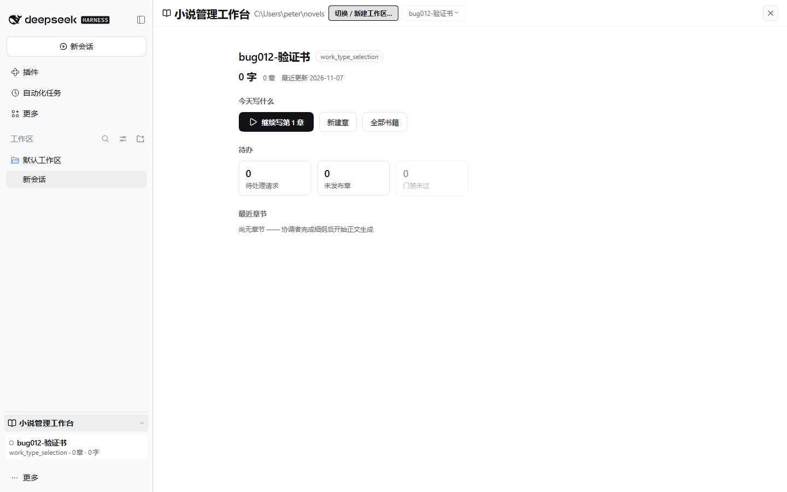

问题不在留白多少，而在**谁在画面中心**：

1. 四块内容（当前书 / 今天写什么 / 待办 / 最近章节）权重接近，眼睛没有落点；「今天写什么」把本应由产品做的判断又抛回给用户。
2. 书是卡片里的一个对象，不是空间里的主角；书封、书名、进度被压成管理信息。
3. 「继续写」与「新建书」都是按钮，主次不清；空态则是一整块空白加一句说明，用户不知道下一步在哪里。
4. 数据是「展示」而不是「叙事」：字数、章节数、时间并排，缺少「上次写到哪一句」这种真正能唤起写作状态的线索。

### 1.2 旧写作台：正文被结构挤成了窄栏

旧写作台（CLEAN-014 取证，测试书《法医仙途》，1400×900）：

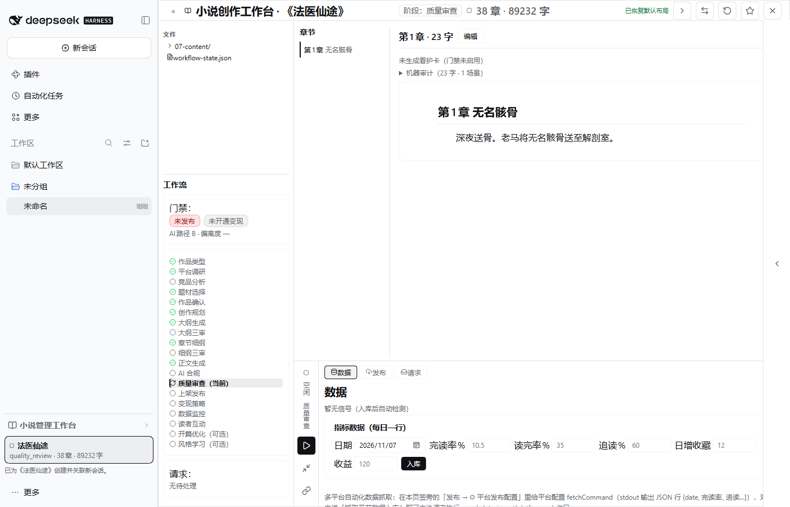

实测事实（DEC-156 / UX-063 取证）：旧取证图 1400×900 下，`.nv-content` 正文区约 236px，按 16px 正文约 15 字/行；写作台有 5 个底部页签、文件树、章节列、检查器。1440 画布下两侧面板只会更宽，正文不会更好。结果是：

1. **正文不是主角**。写作时最重要的东西被夹在两组 chrome 之间，眼睛每读一行都要对抗容器边界。
2. **结构在解释自己**。页签、文件树、检查器、状态条同时在场，用户要学习这个工具，而不是直接进入故事。
3. **对话与正文争抢宽度**。协作编辑是强的，但强到把稿纸压窄，等于用聊天窗口换掉了写作。
4. **状态埋得深**。保存、发布、门禁、请求数分散在页签和抽屉里，写作时不确定「我改的东西在哪、发出去了没有」。

### 1.3 旧空态：一句说明，没有路径

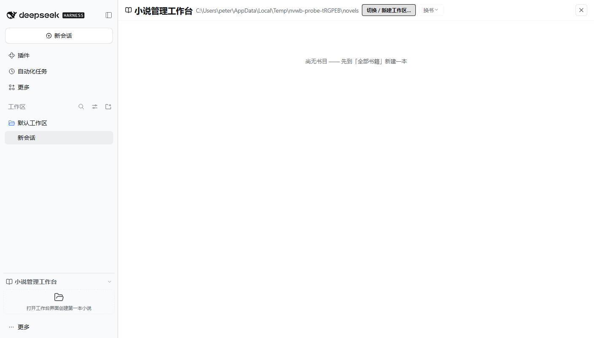

空态只说了「尚无书目」，没有回答三个问题：这是什么、第一步做什么、做完会得到什么。大片空白被浪费，且「全部书籍」这个二级概念被提前暴露。

### 1.4 根因

| 层 | 问题 |
|---|---|
| 信息架构 | 按「功能模块」组织，而不是按「写作任务流」组织；首屏是仪表盘，写作台是 IDE |
| 视觉语言 | 用了宿主的语义色，但没有建立编辑体的字阶、留白和阅读节奏；卡片和边框承担了过多层级 |
| 交互 | 主 CTA 不唯一；进入正文的路径长；空态/加载/失败没有设计；状态可见性弱 |
| 验收 | 之前以几何量算和合规检查为主，缺少「人是否愿意在这里写下去」的判断；±1px 的修订无法改变感知 |

这次不重复那个错误：**下面的审美标准和易用性验收，不以数字打勾代替人的判断**。

---

## 2. 审美标准：墨纸 / 文学编辑体

### 2.1 六个原则

1. **书是主角**。书封、书名、正文占据最大面积；chrome 退到边缘，必要时才出现。
2. **一屏一动作**。每个屏幕只有一个实心主按钮；其余动作是文字链、图标或状态栏入口。
3. **编辑体，不是后台体**。标题、书封、正文用衬线（Noto Serif SC）；UI 用无衬线（Noto Sans SC）。不把整套 UI 做成衬线，也不把正文做成 UI 字号。
4. **纸与墨**。暖纸底、墨色字、朱砂只做印章/分隔/极少量强调；禁用玻璃拟态、发光、渐变按钮、彩色 KPI 卡。
5. **留白是结构**。用 8pt 节奏和细分隔线组织空间，不用「卡片套卡片」；能一条线解决的分组，不加底板。
6. **克制的状态**。成功/警告/错误只以小圆点、细条或一行文字出现；状态色不铺满按钮，不做红绿 Rainbow。

### 2.2 参考系

- **DSH 宿主与插件**：主区域边界、遮罩、焦点环、深色配对、密度与键盘习惯。设计不另造一套宿主外壳，只在宿主给的画布上做书斋。
- **文学编辑体**：书封的竖排书名与印章、running head、页码/页脚、正文首行缩进与段距；参考纸书的阅读节奏，不照搬纸书的装饰。
- **写作工具**：约 34em 的正文 measure、专注模式、页边批注式对话；参考 `docs/research/UX-063-writing-app-layouts.md` 与 `docs/research/UX-053-visual-design-research.md`。
- **反参考**：后台 dashboard、IDE 多面板、玻璃卡片、渐变 CTA、emoji 图标、五页签。凡让用户先理解工具再写字的，都不采用。

### 2.3 审美验收（人来判断）

审核时只看四个问题：

1. 第一眼是否知道「现在该写哪本、写哪章」。
2. 是否愿意在这个正文区域连续写 30 分钟。
3. 关掉对话后，界面是否仍然完整、不空。
4. 浅色与深色是否像同一本书的两种光线下阅读，而不是两套主题。

数字检查只是地板：对比度、点击区、行宽、焦点环是必须过，但**过了也不等于好看**。

---

## 3. 易用性验收：从人的直觉出发

### 3.1 Nielsen 十项检查

| 启发式 | 在这个设计里的落点 |
|---|---|
| 系统状态可见 | 顶部「已保存」；底部「本章未发布 · 门禁未启用」；加载用骨架，不显示假 0 |
| 贴合真实世界 | 「书斋 / 书架 / 稿纸 / 章节目录 / 协作编辑」；不用「资源 / 实例 / 面板」 |
| 用户可控 | 保存可手动触发；对话差异待确认；Esc 退出专注/关闭浮层；删除有二次确认 |
| 一致与标准 | 一个主按钮；一个保存状态；一个发布状态；一个字数；键盘一致 |
| 防错 | 正文未保存切换章节先确认；发布前显示缺什么；危险操作写清对象名 |
| 识别而非回忆 | 章节列表常驻；上次写到的句子在首屏；快捷键提示贴在控件旁 |
| 灵活高效 | ⌘K 找章节、⌘S 保存、Esc 退出、⌘\ 专注；最近章节一键直达 |
| 美学与极简 | 每屏只保留当前任务需要的东西；不使用装饰性卡片 |
| 错误可恢复 | 保存失败就地提示 + 重试；冲突给「保留本地 / 载入磁盘」；不丢稿 |
| 帮助与文档 | 空态「开书三步」、输入框下的一句范围说明；不写长篇教程 |

### 3.2 任务走查

| 任务 | 旧路径 | 新路径 | 目标 |
|---|---|---|---|
| 打开就写 | 选书 → 首页 → 找章节 → 写作台 | 书斋「打开第 38 章」→ 正文末尾 | 1 次点击进入正文 |
| 续写下一章 | 首页 CTA → 工作流 → 等生成 | 书斋「续写第 39 章」→ 工作流 | 1 次点击发起，明确是第 39 章 |
| 新建一本书 | 全部书籍 → 新建 → 填表 | 空态「新建第一本书」/ 顶栏「新建书」→ 书名 | 1 个主入口，不先跳列表 |
| 切换章节 | 章节列 → 点选（可能丢滚动） | 左栏章节目录 → 点选；未保存先确认 | 常驻、可搜索、当前位置可见 |
| 发布 | 底部页签 → 发布 → 检查 | 顶栏「发布」→ 预检 → 确认 | 发布状态与缺项一眼可见 |
| 问 AI | 打开对话页签 / 抽屉，正文被挤 | 右栏协作编辑；专注模式隐藏 | 对话不夺走正文；差异可确认 |
| 换书 | 返回全部书籍 → 选书 | 顶栏「书斋」→ 书架 → 选书 | 两步内回到另一本 |

### 3.3 交互不变量

- 每个屏幕只有一个实心主按钮；主按钮文案必须是**动作 + 对象**（「续写第 39 章」），不用「继续」。
- 可点击控件视觉高度 ≥32px；文字链级动作允许 28px，但实现时用透明外扩保证 32px 命中区。
- 键盘：⌘K 找章节、⌘S 保存、Esc 关闭/退出、⌘\ 专注、⌘J 聚焦对话。
- 保存：手动保存语义不变（⌘S + 按钮），不做「自动保存」的承诺；保存后显示「已保存 · N 字」。
- 破坏性操作：删除书/章节必须二次确认并写出对象名；不提供无确认的批量删除。
- 加载：骨架 + 「正在读取第 38 章」；错误：就地一行 + 重试；空：一句引导 + 一个主按钮。
- 焦点：统一 2px 朱砂焦点环，键盘可见；对话框焦点陷阱；`prefers-reduced-motion` 下关闭非必要动效。
- ARIA：图标按钮有 `aria-label`；章节目录是导航地标；对话是 `aria-label="协作编辑"`；状态变化用 `aria-live="polite"`。
- 浅色/深色同结构、同层级、同对比标准；不是两套布局。

---

## 4. 信息架构

### 4.1 书斋（NvConsole）

```
┌ 顶栏：书斋 · 工作区 D:\AI\writing · 搜索 · 新建书 · 关闭 ┐
├ 当前书：正在写 · 第 38 章                                  ┤
│   《诡异副本，先过审》                                      │
│   规则怪谈 · 长篇 · 38 章 · 8.9 万字 · ● 质量审查中          │
│   [续写第 39 章]   打开第 38 章 →                           │
│   续写会按大纲生成下一章；打开上一章可继续修改正文。          │
│                                        ┌ 上次写到 ────────┐ │
│                                        │ 他看了三秒。...   │ │
│                                        │ 「……明天，先过审，再说。」│
│                                        │ 第 38 章 · 排班表  │ │
│                                        └──────────────────┘ │
├ 书架 4 本                                    最近编辑 ⌄  全部书籍 → ┤
│  [书封 190×274] [书封] [书封] [书封] [＋ 新建书]              │
├ 书案 · 38 章未发布 · 0 个请求 · 质量审查中     第 38 章保存 8月25日 22:26 ┤
└──────────────────────────────────────────────────────────────┘
```

- 首屏不再有「今天写什么」「待办」「最近章节」三块；它们的信息被吸收进当前书的状态、上次写到的引文和书架。
- 书封保留 190×274 的纸书比例；书名竖排、印章在右下；封面不加载图片时用纸色 + 书名排版，不用破图。
- 「续写第 39 章」= `max(章号)+1` 的 AI 工作流，不是「打开第 38 章」；两个动作分开，避免把「续写」误解成「继续编辑上一章」。
- 书架为空时，整个中段变成「从第一本书开始」，不是一张空卡片。
- 顶栏搜索只在有书时出现；空态不摆搜索和排序，避免先让用户面对无效控件。

### 4.2 写作台（StudioView）

```
┌ 顶栏：← 书斋 | 诡异副本，先过审 | ● 质量审查 | ● 已保存 | 发布 | ⋯ | ✕ ┐
├ 左栏 196：书封/书名 · 38 章 · 8.9 万字 · 找章节 ⌘F · 章节目录 38 ──────────┤
│   27 无据的单 … 37 你像一个人 [38 排班表] · ＋新建章节 · 大纲/人物/设定     │
├ 稿纸 588：第 38 章/38 · 2,474 字 · T · ⛶                                  │
│   第 38 章 · 排班表 · 草稿 · 本章保存 8月25日 22:26                        │
│   —— 正文，16/1.95，首行缩进 2em，段距 0.8em ——                            │
│                                                    2 / 2（页码）          │
├ 右栏 300：协作编辑 · DeepSeek · 长篇模式 · 已读第 38 章 · 2,474 字          │
│   编辑消息 / 用户消息 / 「已压掉 63 字 · 待确认」/ 查看差异                 │
│   快捷：查逻辑 润色这段 下一章 · 输入框 · 会读取本章与大纲，未确认的段落不会改动 │
├ 状态栏：本章未发布 · 门禁未启用                 工作流 · 数据 · 发布 38 · 请求 0 ┤
└──────────────────────────────────────────────────────────────────────────────┘
```

- 顶部只保留「书斋 / 书名 / 质量审查 / 保存 / 发布 / 更多 / 关闭」；不再有五个页签。
- 左栏是**章节目录**，不是文件树；文件树降级为「资料」，写作时不出现。
- 正文列固定约 588px（约 34–36 汉字/行），不随窗口无限拉伸；超宽屏留白，不把行宽拉到 100 字。
- 右栏协作编辑 300px；比旧对话窗窄，但保留完整对话、差异确认、快捷动作和输入框。
- 状态栏只放「本章未发布 / 门禁」和四个轻入口（工作流 / 数据 / 发布 / 请求）；不再把发布做成一个大页签。
- 对话里的修改以「差异待确认」出现，正文不先变；「查看差异」打开对比，确认后才应用。没有「AI 已自动改好」的假象。

### 4.3 专注模式

- 入口：稿纸右上角 ⛶ / ⌘\；退出：Esc 或再次点击。
- 隐藏左栏、右栏、发布、更多、状态栏；顶部只留书斋、书名、质量审查、保存、关闭。
- 稿纸居中 680px，留白更大；正文列不因隐藏侧栏而无限变宽。
- 底部右下角只留「专注模式 · Esc 退出」；页码仍在稿纸页脚。
- 专注模式里没有「协作」页签——需要对话时退出专注，不在专注里塞一个半隐藏的聊天。

---

## 5. 屏幕说明

### 5.1 书斋 · 浅色 / 深色

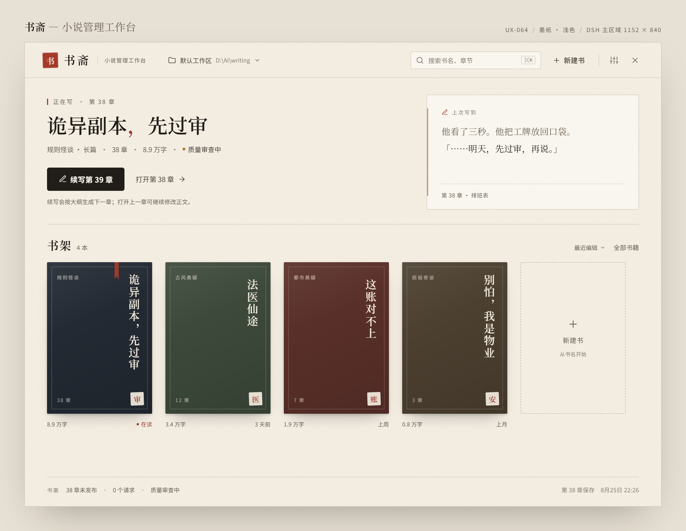

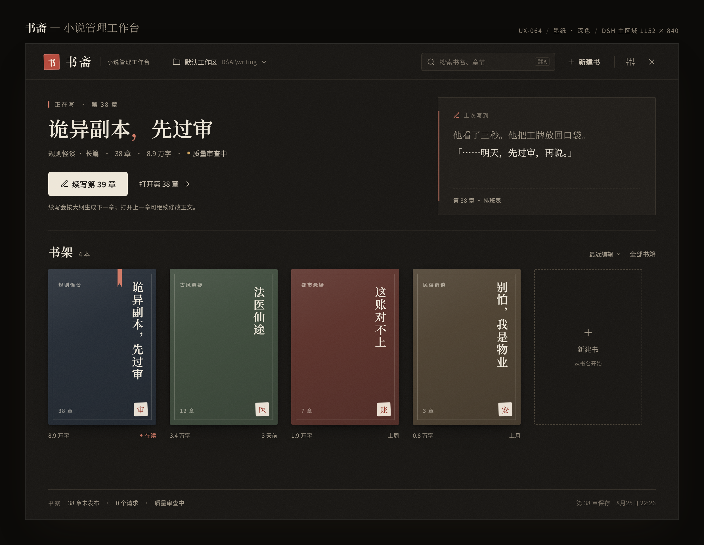

- 顶栏 64px：左侧朱砂印章「书」+ 书斋衬线字标 + 「小说管理工作台」；中间工作区路径；右侧搜索、新建书、设置、关闭。
- 当前书区：小标题「正在写 · 第 38 章」；衬线大标题；一行元信息；主按钮「续写第 39 章」；次级文字链「打开第 38 章」；下面一行说明，解释两个动作的差别。
- 上次写到：纸色卡片，左侧朱砂细条；引文用衬线 16/1.95；底部「第 38 章 · 排班表」；没有多余链接。
- 书架：4 本书 + 新建位；每本下方只留「字数 + 最近编辑」；不在书封上堆进度条。
- footer：一条细线，左侧书案状态，右侧第 38 章保存时间（取自正文文件 mtime）；不放按钮。
- 深色不是反色：纸色变暖黑，墨色变米白，朱砂变柔；书封的色相保留，但整体压暗，避免彩色噪点。

### 5.2 书斋 · 空态

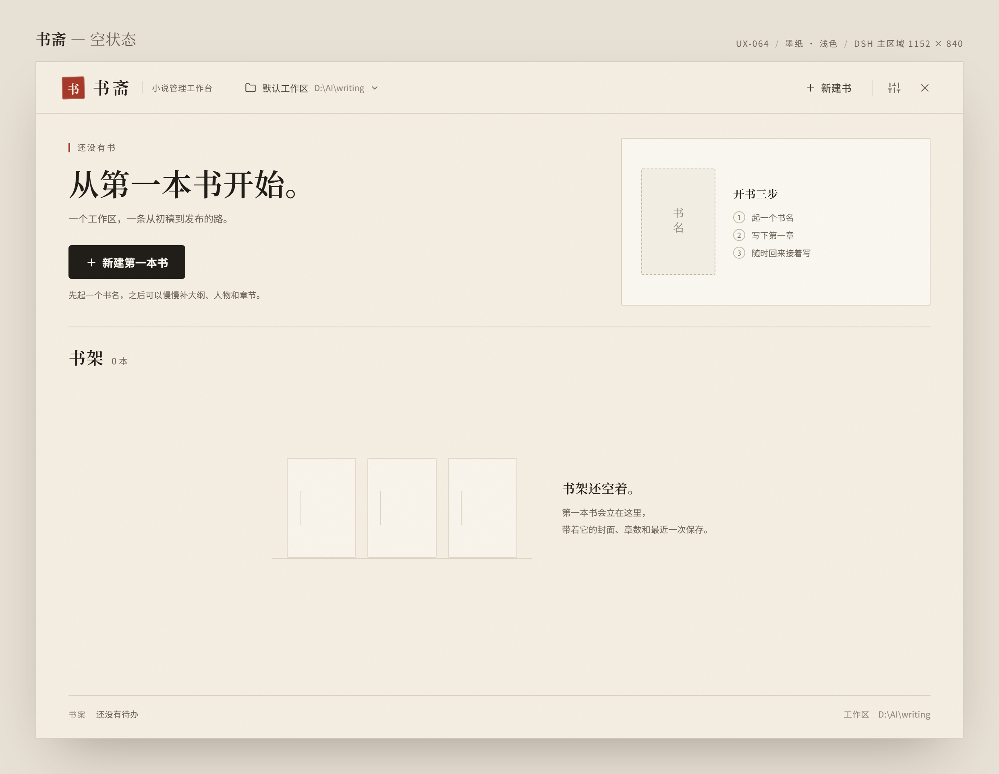

- 主文案「还没有书 / 从第一本书开始。」；主按钮「新建第一本书」；一句范围说明。
- 右侧「开书三步」是解释卡，不是第二个 CTA：① 书名与类型 ② 核心设定 ③ 第一章。纸色底、无阴影，避免读成浮层。
- 书架区保留一条 1px 书脊线，三本虚线 ghost 书示意「这里会长出书」，不是巨大的虚线框。
- 空态不显示搜索、排序、全部书籍；这些在有书后才有意义。
- footer 只留「书案 · 还没有待办 · 工作区 D:\AI\writing」，不显示假的 0 章/0 字统计。

### 5.3 写作台 · 浅色 / 深色

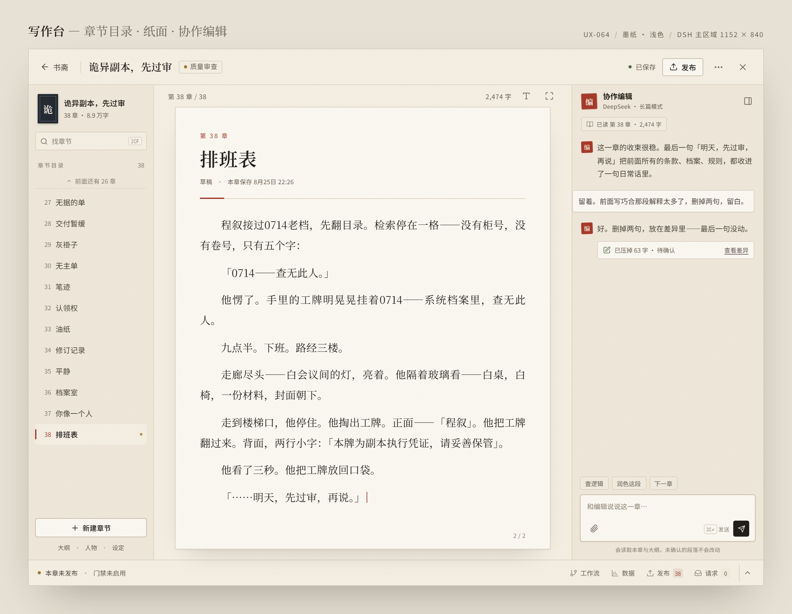

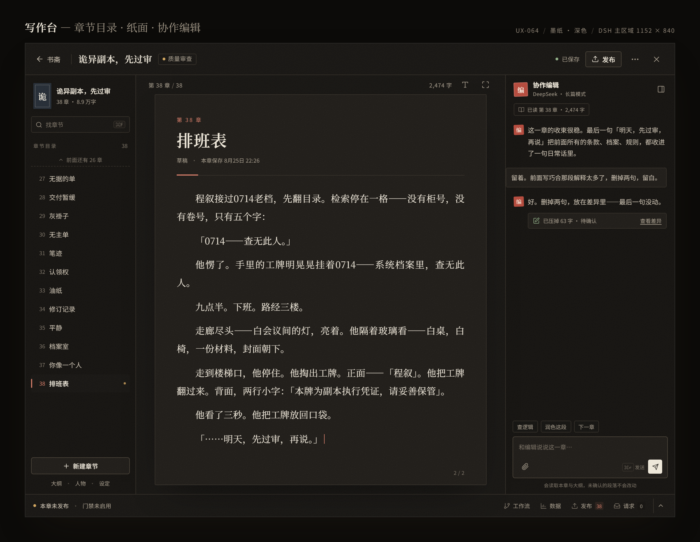

- 顶栏：返回书斋、书名、质量审查 chip、保存状态、发布、更多、关闭；保存状态只出现一次。
- 左栏 196px：书封 + 书名 + 38 章 · 8.9 万字；找章节 ⌘F；章节目录 38 条；当前第 38 章高亮；底部新建章节 + 大纲/人物/设定三个文字入口。
- 稿纸：章节 kicker「第 38 章」、标题「排班表」、草稿与本章保存时间（文件 mtime）、朱砂短横线；正文 16/1.95，首行缩进 2em，段距 0.8em；页脚页码 `2 / 2`。
- 稿纸展示的是**章节结尾**（滚动到末尾），章节头固定；所以对话里讨论最后一句时，正文和对话在同一视野。
- 右栏：协作编辑头、模型与模式、已读范围、消息、差异卡「已压掉 63 字 · 待确认 / 查看差异」、快捷动作、输入框、范围说明。
- 状态栏：左侧「本章未发布 · 门禁未启用」；右侧工作流、数据、发布 38、请求 0、收起。
- 深色下正文仍保持纸的暖度，不用纯黑底白字；对话、稿纸、状态栏是同一套层级，而不是三个独立面板。

### 5.4 专注模式 · 浅色 / 深色

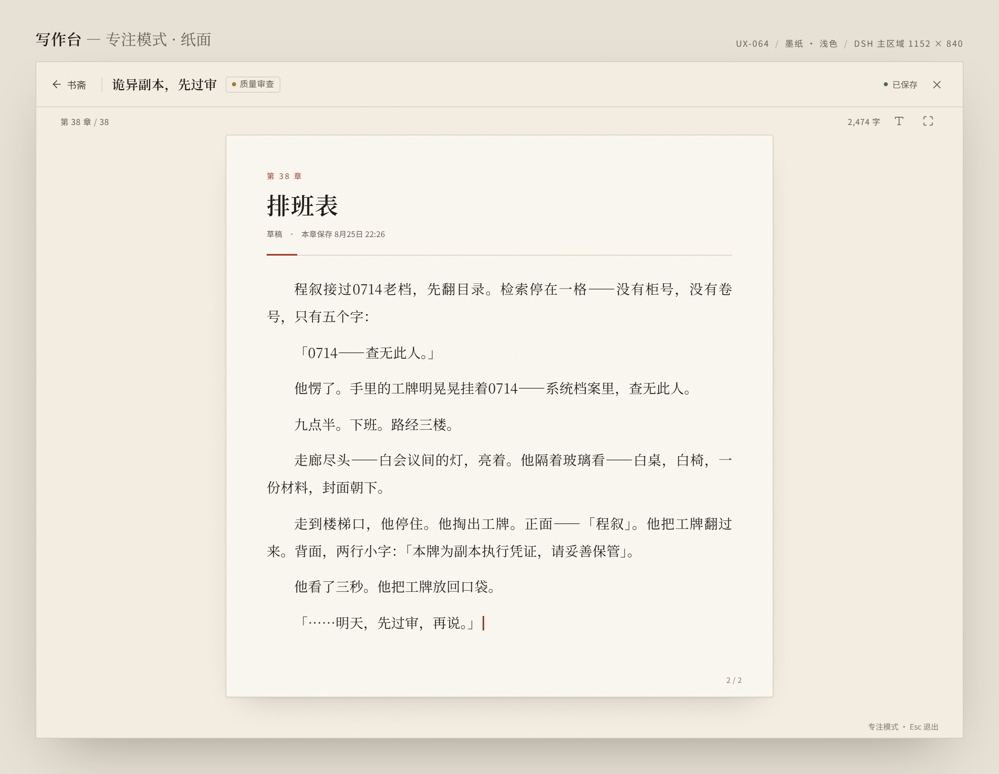

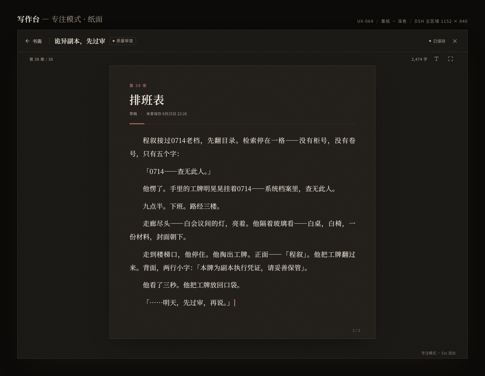

- 只有顶栏 + 稿纸；没有左栏、右栏、发布、更多、状态栏。
- 稿纸 680px 居中；正文行宽仍受控；页码在页脚右下。
- 右下角唯一提示「专注模式 · Esc 退出」，不抢正文。
- 没有协作页签；需要对话时退出专注。专注是真正的「只剩这一章」。

### 5.5 组件规范

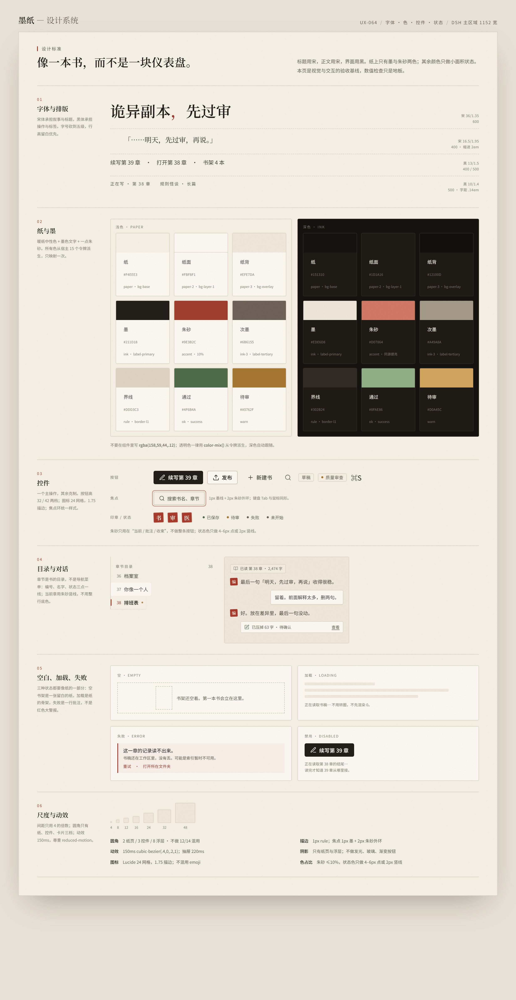

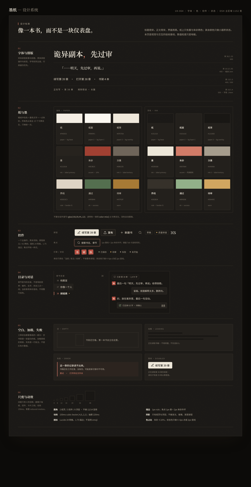

六个分区：

1. **字体与排版**：书封/标题衬线，UI 无衬线；字阶、行高、首行缩进、字距。
2. **纸与墨**：9 个色板（纸/纸-2/纸-3/墨/朱砂/墨-3/线/成功/警告），浅深各一套；标注来源。
3. **控件**：主/次/文字按钮，输入框，chip，圆点，焦点环，禁用态；高度 32/36/42。
4. **目录与对话**：章节行、当前行、对话消息、差异卡、输入框。
5. **空白/加载/失败/禁用**：骨架、空态、错误、禁用四种状态。
6. **间距与规则**：8pt 间距、圆角 2/3/8、细分隔线、书封/稿纸的纸张厚度、浮层阴影。

这张图是实现时的**唯一视觉字典**；实现不得引入图外的新颜色、新圆角、新阴影。

---

## 6. 交互规格

| 场景 | 触发 | 反馈 | 边界/失败 |
|---|---|---|---|
| 续写下一章 | 书斋主按钮「续写第 N+1 章」 | 按钮进入 loading；显示「正在准备第 N+1 章」骨架；进入写作台后由工作流生成 | detail 未就绪 → 按钮禁用 + 「数据加载中」+ 重试；不得用 overview 计数推算章号 |
| 打开上一章 | 书斋「打开第 38 章」 | 直接进入写作台第 38 章，滚动到末尾 | 章节不存在 → 提示并回到目录；不静默打开第 1 章 |
| 保存 | ⌘S / 顶栏保存 | 「已保存 · N 字」；按钮短暂禁用；不弹成功弹窗 | 冲突 → 对话框「保留本地 / 载入磁盘」；失败 → 就地错误 + 重试，不丢稿 |
| 切换章节 | 左栏点章节 | 若正文 dirty，先确认；确认后载入新章，滚动到开头 | 载入失败保留当前章；不把未保存内容替换掉 |
| 发布 | 顶栏「发布」 | 打开预检：缺项列表 + 继续/取消；成功后状态变「已发布」 | 门禁未启用 → 按钮仍可打开说明，不假装发布成功；失败保留草稿 |
| 问 AI | 右栏输入 / 快捷动作 | 消息进入线程；修改以差异卡返回；正文不变 | 差异未确认 → 不写入；关闭写作台前提示未确认差异 |
| 查看差异 | 差异卡「查看差异」 | 打开对比视图：删除/新增高亮；可确认或放弃 | 确认后一次写入并保存；放弃则保留原文 |
| 专注 | ⛶ / ⌘\ | 隐藏侧栏与状态栏，稿纸 680 居中 | Esc 退出；退出后恢复原滚动位置与光标 |
| 找章节 | ⌘K / ⌘F | 章节目录搜索，键盘上下选择 | 无结果 → 「没有匹配章节」+ 清除 |
| 删除书/章 | 更多菜单 | 二次确认，写出书名/章名 | 不允许无确认删除；失败保留原数据 |
| 关闭 | ✕ / Esc | 有未保存修改 → 确认；无修改直接回书斋 | 关闭不退出宿主，不杀会话 |

### 6.1 状态与文案

| 状态 | 文案 | 位置 |
|---|---|---|
| 已保存 | 已保存 | 顶栏；状态只出现一次，时间在稿纸页眉作草稿元数据 |
| 保存中 | 保存中… | 顶栏，替换保存态 |
| 保存失败 | 未保存 · 重试 | 顶栏，错误色小点 + 可点 |
| 未发布 | 本章未发布 | 状态栏左侧 |
| 门禁 | 门禁未启用 / 门禁通过 / 缺 N 项 | 状态栏左侧 |
| 质量审查 | 质量审查中 | 顶栏 chip / 书斋元信息 |
| 差异待确认 | 已压掉 63 字 · 待确认 | 对话差异卡 |
| 加载 | 正在读取第 38 章… | 稿纸骨架 + aria-live |
| 空章节 | 这一章还没有正文。/ 开始写第一句 | 稿纸空态 |
| 错误 | 读取失败。/ 重试 | 稿纸内联，不弹窗 |

时间统一本地化；不使用「今天/昨天」这类相对时间做关键状态，避免跨天误读。演示稿里的 `9月23日 11:37` 是工作流统计状态的本地更新时间，`8月25日 22:26` 是第 38 章正文文件 mtime；两者不混用，也不把统计更新说成正文保存。

---

## 7. 设计系统

### 7.1 色彩：先映射宿主，再落纸色

实现时在 `lib/client.js` 的根作用域一次性映射为 `--nv-*`，组件只用 `--nv-*`：

| 语义 | 浅色 | 深色 | 来源 |
|---|---|---|---|
| 纸 | `#F4EEE3` | `#151310` | `--dsw-alias-bg-base` |
| 纸-2（稿纸/卡） | `#FBF8F1` | `#1D1A16` | `--dsw-alias-bg-layer-1` |
| 纸-3（浮层/深纸） | `#EFE7DA` | `#12100D` | `--dsw-alias-bg-overlay` |
| 墨 | `#211D18` | `#EDE6D8` | `--dsw-alias-label-primary` |
| 墨-2 | `#4A433A` | `#C9BFAF` | `--dsw-alias-label-secondary` |
| 墨-3 | `#6B6155` | `#A49A8A` | `--dsw-alias-label-tertiary` |
| 线 | `#DDD3C3` | `#302B24` | `--dsw-alias-border-l1` |
| 线-强 | `#C9BCA7` | `#463F34` | `--dsw-alias-border-l2` |
| 悬停底 | 宿主值 | 宿主值 | `--dsw-alias-interactive-bg-hover` |
| 浮层阴影 | 宿主值 | 宿主值 | `--dsw-shadow-lv2` |
| 朱砂 | `#9E3B2C` | `#D07864` | 本插件唯一品牌强调色，声明一次 |
| 印 | `#A63A2A` | `#B4483A` | 印章/极小面积 |
| 成功 | `#4F6B4A` | `#8FAE86` | `--dsw-alias-state-success-primary` |
| 警告 | `#A5762F` | `#D0A45C` | `--dsw-alias-state-warn-primary` |
| 危险 | `#A33A2E` | `#D97868` | `--dsw-alias-state-error-primary` |

- 朱砂是唯一不来自宿主语义色的强调色；只在印章、分隔短横、焦点环、差异卡左侧出现，面积 ≤10%。
- 所有浅色/深色组合按 WCAG AA 正文对比度校验；状态色只做小点/细条，不铺底。
- 不使用 `rgba()` 手写强调色；透明色用 `color-mix(in oklab, ...)` 从语义色派生。
- 宿主 `--dsw-alias-brand-primary` 不进入纸面与主按钮：主按钮用墨色，品牌感由朱砂印章/焦点环承担，避免宿主蓝把书斋拉回「后台」。`--dsw-font-family` 仍按契约登记，但正文用明确的 Noto Serif SC 栈；该 token 的未使用状态由 UX-062 跟踪，不在本次设计中偷偷改口径。

### 7.2 字体与字阶

| 角色 | 字体 | 字号/行高 | 用途 |
|---|---|---|---|
| 书斋字标 | Noto Serif SC 600 | 21/1 | 顶栏「书斋」 |
| 书封书名 | Noto Serif SC 600 | 20/1.5（长书名 18） | 竖排封面 |
| 当前书标题 | Noto Serif SC 600 | 36/1.24 | 书斋 h1 |
| 章节标题 | Noto Serif SC 600 | 30/1.3 | 稿纸章名 |
| 正文 | Noto Serif SC 400 | 16/1.95 | 稿纸；首行缩进 2em，段距 0.8em |
| 区块标题 | Noto Serif SC 600 | 21/1.2 | 书架/目录/协作编辑 |
| UI 正文 | Noto Sans SC 400 | 13/1.6 | 按钮、行、说明 |
| UI 强调 | Noto Sans SC 600 | 13/1.4 | 主按钮、当前章节 |
| meta | Noto Sans SC 400 | 10.5–12/1.5 | 字数、时间、状态 |
| 印章 | Noto Serif SC 600 | 13/1 | 方形印章 |

- 字重只用 400/500/600；不用 700 以上，避免「后台标题」感。
- 正文不用 `text-align: justify`；中文两端对齐会造成字距抖动。
- 不用负字距；书封竖排可用 0.06–0.16em 的宽字距，UI 不用。

### 7.3 间距、圆角、阴影、动效

- 8pt 节奏：4/8/12/16/24/32/48/64；区块之间 32–48，控件内 8–12。
- 圆角：2（按钮/输入）、3（小卡/印章）、8（浮层/大卡）；不做 16px 以上的「软糖」圆角。
- 阴影：书封与稿纸允许极轻的「纸张厚度」；正文卡不用阴影，用 1px 线分层次；菜单/对话框等真正浮层用 `--dsw-shadow-lv2`。
- 动效：150ms `cubic-bezier(.4,0,.2,1)`；只用于 hover、抽屉、焦点、消息进入；不做弹跳/缩放；`prefers-reduced-motion` 关闭。
- 图标：Lucide 线性图标，16/18px，1.75 描边；不使用 emoji，不混用第二套图标。

### 7.4 布局尺寸

| 区域 | 尺寸 |
|---|---|
| 宿主主区域画布 | 1152×840（1440×900 宿主 − 288 侧栏） |
| 书斋顶栏 | 64 |
| 书封 | 190×274 |
| 写作台顶栏 | 52 |
| 左栏 | 196 |
| 稿纸 | 588（专注 680） |
| 右栏 | 300 |
| 状态栏 | 36 |
| 正文 measure | 约 34–36 汉字/行 |

响应式（实现补齐，不在本次出图范围）：<1100 右栏收为抽屉（沿用 420px 抽屉语义）；<960 左栏可折叠；<760 不承诺双栏，改为单栏 + 目录抽屉。桌面 1152 是本次验收画布。

---

## 8. 实现映射与批次（审核通过后才开始）

### 8.1 代码面

| 面 | 位置 | 改动 |
|---|---|---|
| 书斋 | `lib/client.js` `NvConsole` / `.nv-home` | 重写首屏 body：当前书 + 引文 + 书架 + footer；移除「今天写什么/待办/最近章节」三块；保留数据源与 CTA 逻辑 |
| 写作台 | `lib/client.js` `.nv-split` / `StudioView` | 顶栏 + 左栏目录 + 稿纸 + 协作栏 + 状态栏；移除五页签/文件树/检查器主位；专注模式 |
| 编辑器 | `lib/client.js` `.nv-edwrap` / 保存逻辑 | 保留 read/edit 切换、⌘S、冲突处理；正文 16/1.95、2em 缩进、0.8em 段距；页脚页码 |
| 对话 | `lib/client.js` chat drawer | 收为 300px 右栏；差异卡「待确认/查看差异」；未确认不写正文；专注模式隐藏 |
| 样式 | `lib/client.js` CSS / `NV_STYLE` | 用 `--nv-*` 重写书斋/写作台；不新增全局样式；不覆盖宿主 |
| 契约 | `lib/host-contract.mjs` | 本设计不新增宿主字面量；实现若新增 selector/token 族，按 P-10 登记 + smoke 双向断言 |
| API | `lib/index.js` | 不改 API 形状；detail/overview 现有字段够用；不新增网络请求 |

### 8.2 三批

1. **S1 书斋**：首屏骨架 + 书架 + 引文 + footer + 空态；保留现有数据流；加 loading 骨架；smoke 断言「首屏只有一个主 CTA」「书架空态不显示搜索」。
2. **S2 写作台**：顶栏 + 左栏 + 稿纸 + 协作栏 + 状态栏 + 专注；章节滚动到末尾；差异待确认；smoke 断言「正文列宽 588±2」「专注隐藏左右栏」「保存状态只出现一次」。
3. **S3 收口**：浅深配对、焦点环、reduced motion、空/错/禁用四态、组件对照；`verify-visual-geometry` 扩测；截图证据。

每批一个可回退 commit；不跨批混改；每批跑 `node --check` + `validate-preset` + `smoke` + geometry，结果入 evidence。当前基线：smoke 342/0、anchors 79 段、preset 29/29。

### 8.3 不做

- 不改业务 API、不改数据结构、不迁移 localStorage key。
- 不承诺自动保存；不把「未确认的 AI 修改」写进正文。
- 不删除已修的真实缺陷守卫（焦点、对比度、44px、输入框盒模型、段落断言）。
- 不在本次引入新依赖、新图标库、新字体文件；使用系统已装的 Noto Serif SC / Noto Sans SC，缺失时回退到系统衬线/无衬线。

---

## 9. 风险与开放项

| 风险/开放项 | 影响 | 处置 |
|---|---|---|
| D2「打开书直接到最后一章」改变旧「今天写什么」习惯 | 用户可能想先看首页决策 | 首屏保留上次写到的引文和「打开第 38 章」；如审核要求，可恢复一个轻量「今天写什么」行，但不做成四卡 |
| 书架 4 本为示意，真实只有 1 本 | 用户误以为设计假设多书 | 图中与本文均标注；实现按真实书目数量自适应，1 本时书封 + 新建位，不拉伸出假书 |
| 对话差异是静态示意 | 实现时 diff 口径可能不同 | 实现按真实 diff 计算；「已压掉 63 字」仅为版式示例；未确认不写正文 |
| 1152 以下宽度未出图 | 宿主窗口缩小后布局可能挤 | 按 §7.4 响应式规则实现；<1100 右栏变抽屉，<960 左栏折叠；不把小屏当主验收面 |
| 28px 小按钮低于 32px 目标 | 可达性不达标 | 文字链级动作保留 28px 视觉，但实现加透明外扩命中区；主/次按钮 ≥36/42 |
| 治理债 31 issues（UX-061/062/063 合同字段、RISK-002/013 等） | 检查不绿，可能被误读为本次设计失败 | 本任务按完整合同字段登记；旧债在实现批次中逐项收口，不在评审时假装全绿 |
| 审美判断主观 | 通过标准不是打勾 | 以用户目检为准；本文只给判断框架，不用指标替代 |

---

## 10. 审核方式

审核时按屏幕看，不需要逐条读实现：

1. **书斋**：第一眼是否知道写哪本、点哪个；书架是否像书架而不是卡片列表；深色是否仍然是纸。
2. **书斋空态**：是否知道第一步；右侧「开书三步」是否读成第二个按钮。
3. **写作台**：正文是否愿意读 30 分钟；左栏目录是否够用；右栏对话是否抢戏；顶栏状态是否清楚。
4. **专注模式**：是否真的只剩这一章；Esc 提示是否碍眼。
5. **组件**：颜色、字阶、控件是否是一套；浅深是否配对。

可选结论：

- **通过全部**：进入 S1–S3 实现，按批次交付并复检。
- **只调书斋**：写作台/专注/组件先冻结，书斋按批注改后再审。
- **只调写作台**：书斋/空态先冻结，写作台按批注改后再审。
- **只调空态/组件**：其余冻结。
- **要改方向**：停止实现，重做方向提案；不在旧稿上继续叠补丁。

审核意见会写入 `DEC-162` 与 `docs/review/UX-064-R1.md`；通过后才创建实现任务与 lock。

---

## 11. 附件与证据

| 文件 | 用途 |
|---|---|
| `UX-064-mockups/shots/00-contact-sheet.png` | 九图总览（本文顶部） |
| `UX-064-mockups/shots/01-console-light.png` | 书斋浅色 2× |
| `UX-064-mockups/shots/02-console-dark.png` | 书斋深色 2× |
| `UX-064-mockups/shots/03-console-empty-light.png` | 书斋空态 2× |
| `UX-064-mockups/shots/04-studio-light.png` | 写作台浅色 2× |
| `UX-064-mockups/shots/05-studio-dark.png` | 写作台深色 2× |
| `UX-064-mockups/shots/06-studio-focus-light.png` | 专注浅色 2× |
| `UX-064-mockups/shots/07-studio-focus-dark.png` | 专注深色 2× |
| `UX-064-mockups/shots/08-components-light.png` | 组件浅色 2× |
| `UX-064-mockups/shots/09-components-dark.png` | 组件深色 2× |
| `UX-064-mockups/console.html` | 书斋可交互稿（`?theme=dark`） |
| `UX-064-mockups/console-empty.html` | 空态稿 |
| `UX-064-mockups/studio.html` | 写作台稿（`?theme=dark`、`?focus=1`、`?mode=focus-dark`） |
| `UX-064-mockups/components.html` | 组件规范稿（`?theme=dark`） |
| `docs/research/UX-053-visual-design-research.md` | 视觉语言研究基线 |
| `docs/research/UX-063-writing-app-layouts.md` | 写作工具布局研究 |
| `docs/design/UX-063-redesign-spec.md` | 前序结构规格（本提案吸收其真实缺陷修复与守卫） |

复跑设计稿（01–07 与 08/09 各自渲染；总览由独立脚本生成）：

```powershell
# 01–07（工作区根目录）
$w='D:\AI\dev_toolchain\browser_test_tool_list\node-with-playwright.cmd'
$s='.scratch-ux064\shot.cjs'
$b='file:///D:/AI/agent/deepseek/harness/writing-workflow/docs/design/UX-064-mockups/'
& $w $s ($b+'console.html') 'docs/design/UX-064-mockups/shots/01-console-light.png' 1240 960 light
& $w $s ($b+'console.html?theme=dark') 'docs/design/UX-064-mockups/shots/02-console-dark.png' 1240 960 dark
& $w $s ($b+'console-empty.html') 'docs/design/UX-064-mockups/shots/03-console-empty-light.png' 1240 960 light
& $w $s ($b+'studio.html') 'docs/design/UX-064-mockups/shots/04-studio-light.png' 1240 960 light
& $w $s ($b+'studio.html?theme=dark') 'docs/design/UX-064-mockups/shots/05-studio-dark.png' 1240 960 dark
& $w $s ($b+'studio.html?focus=1') 'docs/design/UX-064-mockups/shots/06-studio-focus-light.png' 1240 960 light
& $w $s ($b+'studio.html?mode=focus-dark') 'docs/design/UX-064-mockups/shots/07-studio-focus-dark.png' 1240 960 dark

# 08/09 组件规范 + 00 九图总览
& $w $s ($b+'components.html') 'docs/design/UX-064-mockups/shots/08-components-light.png' 1240 2400 light
& $w $s ($b+'components.html?theme=dark') 'docs/design/UX-064-mockups/shots/09-components-dark.png' 1240 2400 dark
python -X utf8 .scratch-ux064\contact-sheet.py
```

> 以上是设计稿，不是已实现界面。审核通过前不修改 `lib/client.js` 或 `lib/index.js`。

---

## 12. 审核记录（待填）

| 日期 | 审核人 | 结论 | 批注 | 下一步 |
|---|---|---|---|---|
| 2026-11-08 | 用户 | 待审 | — | 通过则 S1；否则按点名屏幕返工 |
